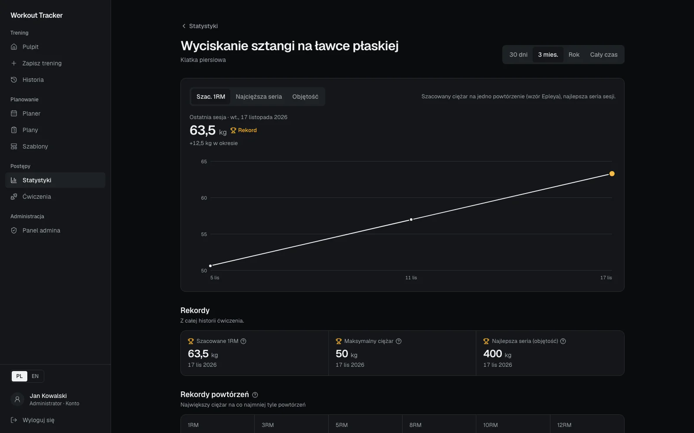
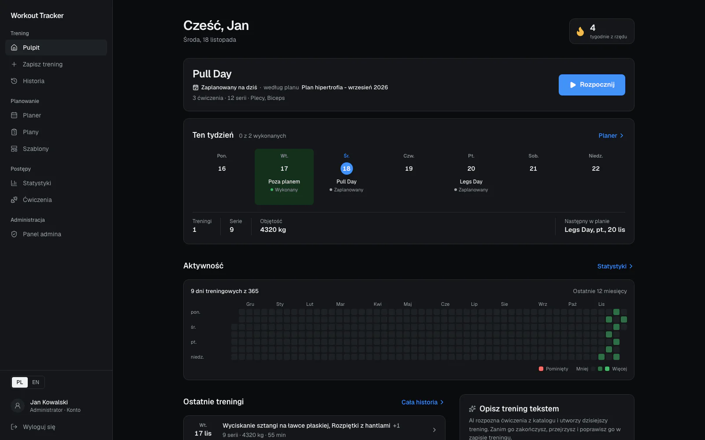
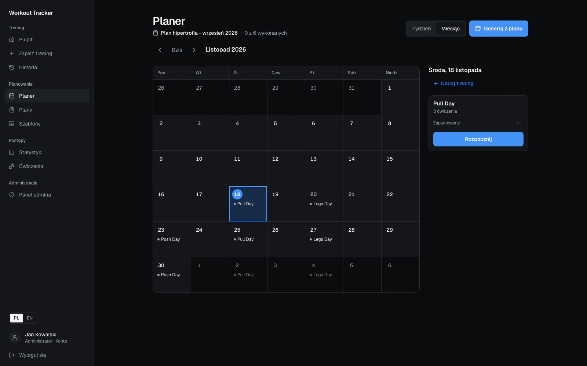
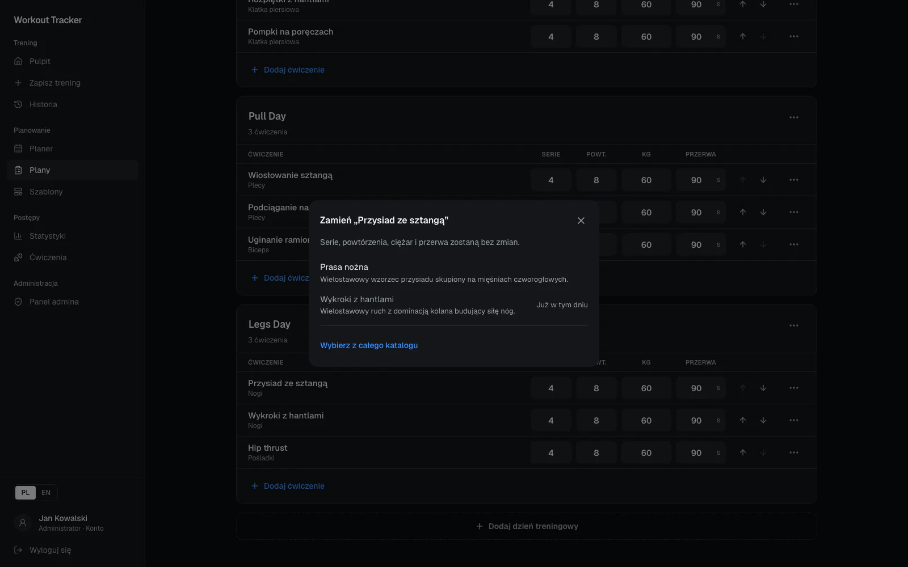
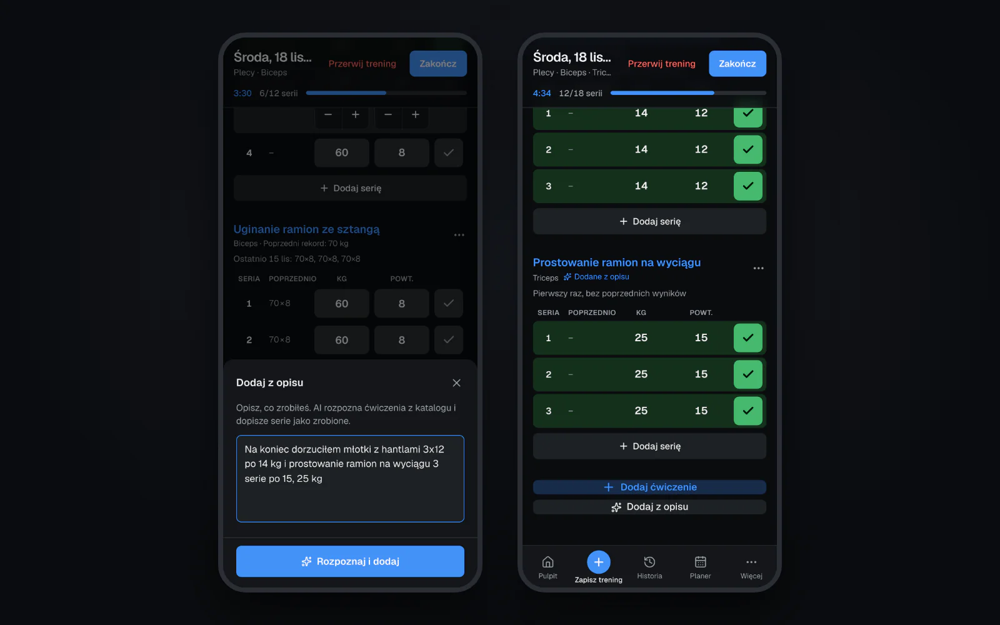
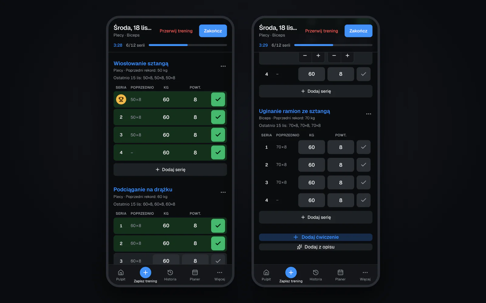
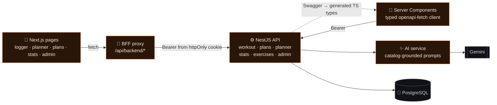
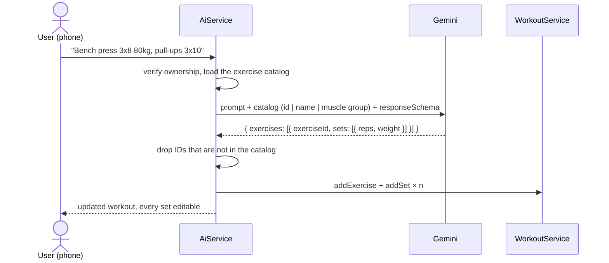

<p align="center">
  
</p>

<p align="center">
  <a href="https://github.com/MaksZiem/workout-tracker/actions/workflows/ci.yml"></a>
  
  
  
  
  
  
  
  
  
  
</p>

<p align="center">
  <a href="#-highlights">Highlights</a> ·
  <a href="#-screenshots">Screenshots</a> ·
  <a href="#-architecture">Architecture</a> ·
  <a href="#-quick-start">Quick start</a> ·
  <a href="portfolio/PORTFOLIO.en.md">Full case study</a>
</p>

---

> **Log fast in the gym, plan and review at your desk.** Log workouts set by set, build plans out of templates, schedule them in a planner and watch your progress in detailed stats. Gemini turns *"bench 3x8 at 80, then pull-ups 3x10"* into logged sets and generates whole training plans, always restricted to the existing exercise catalog.

<p align="center">
  
</p>

## ✨ Highlights

<table>
  <tr>
    <td width="50%" valign="top">
      <h3>🏋️ Mobile-first logger</h3>
      Add exercises and sets, tick them off between sets, duplicate past workouts, or start a session pre-filled with the target sets, reps and weight from a template.
    </td>
    <td width="50%" valign="top">
      <h3>🗓️ Plans → planner</h3>
      Plans group templates (Push / Pull / Legs…). Generate a schedule across a date range without overwriting existing entries, and track <code>PLANNED</code> → <code>COMPLETED</code> / <code>SKIPPED</code> and plan adherence.
    </td>
  </tr>
  <tr>
    <td width="50%" valign="top">
      <h3>📊 Progress that motivates</h3>
      Epley e1RM, personal records, rep records at 1/3/5/8/10/12 reps, weekly volume, muscle-group split, streaks, rep ranges and <b>stagnation detection</b>.
    </td>
    <td width="50%" valign="top">
      <h3>✨ AI you can review</h3>
      Text → workout, goal → plan, and up to 5 exercise substitutes with the same movement pattern. The output is ordinary, editable data, and unknown exercise IDs are filtered out on the server.
    </td>
  </tr>
  <tr>
    <td width="50%" valign="top">
      <h3>🔒 BFF proxy + httpOnly cookie</h3>
      The browser never sees the JWT. A Next.js route handler forwards <code>/api/backend/*</code> with the bearer token, so the backend needs no CORS.
    </td>
    <td width="50%" valign="top">
      <h3>📜 Contract-first full stack</h3>
      Swagger annotations generate the frontend types (<code>openapi-typescript</code> + <code>openapi-fetch</code>), so the UI can't drift from the API.
    </td>
  </tr>
</table>

## 📸 Screenshots

<table>
  <tr>
    <td width="50%"></td>
    <td width="50%"></td>
  </tr>
  <tr>
    <td align="center"><sub><b>Dashboard</b>: today's workout, week strip, streak, fresh records</sub></td>
    <td align="center"><sub><b>Planner</b>: week and month board with session statuses</sub></td>
  </tr>
  <tr>
    <td width="50%"></td>
    <td width="50%"></td>
  </tr>
  <tr>
    <td align="center"><sub><b>Plan editor</b> with AI-picked exercise substitutes</sub></td>
    <td align="center"><sub><b>AI parsing</b> a free-text workout into exercises and sets</sub></td>
  </tr>
</table>

<p align="center">
  <br>
  <sub><b>Mobile workout logger</b>: exercises, sets, weight and reps</sub>
</p>

## 🏗️ Architecture



<details>
<summary><b>🔄 How "parse a workout from text" works</b></summary>



</details>

## 🧰 Tech stack

| | |
|---|---|
| **Frontend** | Next.js 16 (App Router) · React 19 · Tailwind CSS v4 · next-intl (PL/EN) · openapi-fetch · jose |
| **Backend** | NestJS 11 · TypeORM · class-validator · Swagger / OpenAPI |
| **Data** | PostgreSQL: plans → templates → scheduled sessions → workouts → sets |
| **AI** | Google Gemini with `responseMimeType: application/json` and a `responseSchema` |
| **Auth** | JWT behind a BFF proxy · scrypt password hashes · `USER` / `ADMIN` guards |
| **Quality** | Jest (stats helpers, planner, AI parsing and plan generation) · GitHub Actions CI · ESLint · Prettier · `*.http` request files |

## 🚀 Quick start

Requirements: **Node.js**, **PostgreSQL** and a **Gemini API key**.

```bash
# backend → http://localhost:3001  (Swagger: /api/docs)
cd backend
cp .env.example .env          # PORT, DB_*, JWT_SECRET, GEMINI_*, FRONTEND_URL
npm install
npm run migration:run
npm run start:dev
npm run seed:demo             # demo account, exercise catalog, workouts

# frontend → http://localhost:3000
cd ../frontend
cp .env.example .env.local    # BACKEND_URL=http://localhost:3001
npm install
npm run dev
```

## 📁 Project structure

```text
workout-tracker/
├── backend/            NestJS API
│   └── src/
│       ├── workout/  template/  planner/  exercise/
│       ├── stats/      records, e1RM, streaks, stagnation, adherence
│       ├── ai/         parse workout, generate plan
│       ├── gemini/     structured JSON calls with retries
│       └── users/  guards/  database/ (migrations, seed-demo.ts)
├── frontend/           Next.js app (BFF proxy in a route handler)
└── portfolio/          case study (EN/PL) and screenshots
```

## 🗺️ Roadmap

- [ ] Rest timer and plate calculator
- [ ] Progressive overload suggestions based on stagnation data
- [ ] CSV export, PWA with offline logging
- [ ] CI pipeline

## 📖 Read more

The full case study covers the problem, the data model, the API, an example run step by step, key decisions and trade-offs, and what I learned: **[English](portfolio/PORTFOLIO.en.md)** · **[Polski](portfolio/PORTFOLIO.pl.md)**.

---

<p align="center">
  <sub>Built by <a href="https://github.com/MaksZiem"><b>Maksymilian Ziembicki</b></a> · Full-stack developer</sub>
</p>
