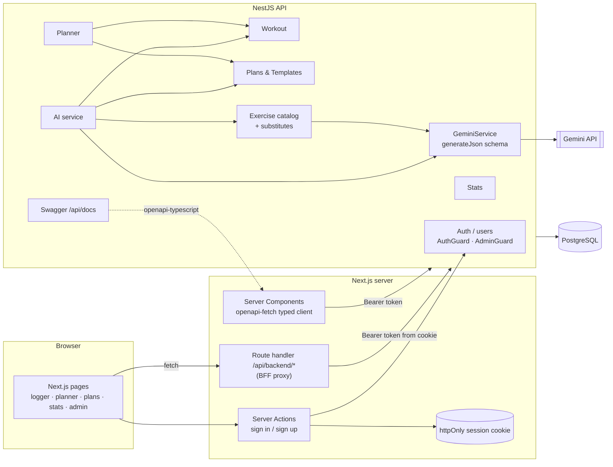
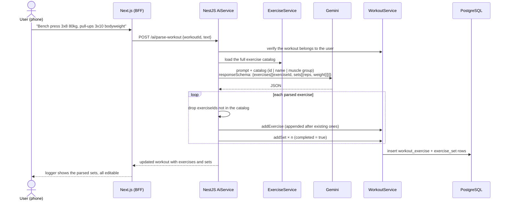
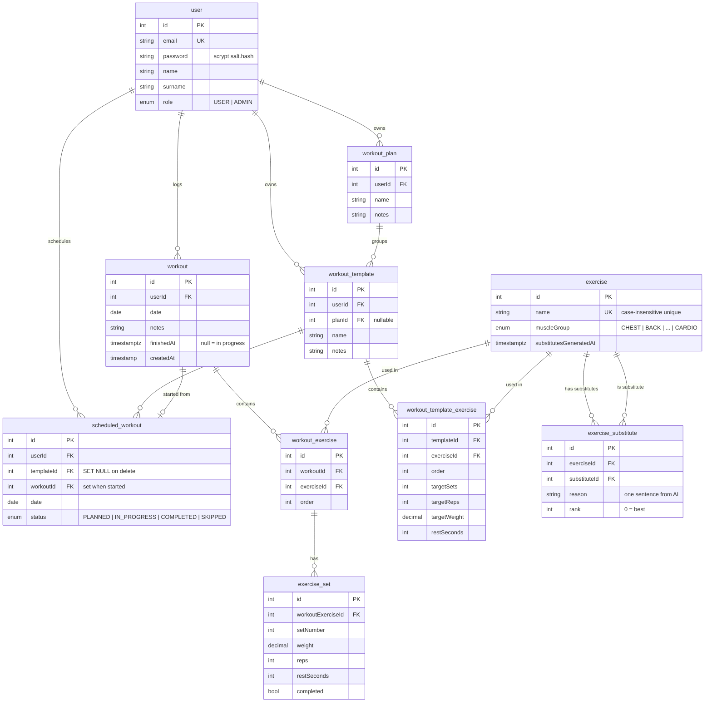

# Workout Tracker

## Overview

Workout Tracker is a full-stack strength training application in the spirit of Strong and Hevy. Users log workouts (exercises → sets with weight, reps and completion), build **plans** made of **templates** (one per training day, with target sets, reps, weight and rest), schedule them in a **planner**, and track progress through detailed **statistics**: estimated 1RM, personal records, rep records, weekly volume, muscle-group distribution, streaks, plan adherence and stagnation detection.

Three features use **Google Gemini**, always restricted to the existing exercise catalog:
- **Parse a workout from text:** *"bench 3x8 at 80, then pull-ups 3x10"* becomes logged exercises and sets.
- **Generate a training plan** from a goal (strength, hypertrophy, endurance or general), days per week and constraints.
- **Pick exercise substitutes:** for each exercise, up to 5 alternatives with the same movement pattern, each with a one-line reason. An admin can review and reject them.

I built it as a university project, so the goal was a complete system in which every backend capability can be reached from a polished UI.

## Problem

Logging in the gym has to be fast: you are on a phone, between sets, with tired hands. Planning and reviewing progress, on the other hand, happens at a desk. Popular apps also make you build every plan by hand and tell you little about *why* progress has stalled.

This app:
- makes logging **fast and forgiving**, with a mobile-first logger, workout duplication, starting a session pre-filled from a template, and an optional "just type what you did" shortcut,
- turns **plans into a calendar** and tracks adherence (planned vs completed vs skipped),
- shows **progress that motivates**: records, streaks, e1RM charts, plus a list of exercises that have stagnated,
- uses AI as an **assistant whose output you can review**, never a black box. Generated plans and parsed workouts are ordinary, editable data.

## Key features

- **Workout logging:** create, edit, duplicate, finish and cancel workouts. Add exercises from the catalog, then add, edit and complete sets.
- **Plans & templates:** a plan groups templates, and each template exercise has an order, target sets, reps, weight and rest time. Exercises can be swapped for an AI-suggested substitute.
- **Planner:** schedule templates on dates with the statuses `PLANNED` / `IN_PROGRESS` / `COMPLETED` / `SKIPPED`. Includes a "today" view, **schedule generation** (e.g. Push → Monday, Pull → Wednesday, Legs → Friday across a date range, without overwriting existing entries), and **starting a scheduled workout**, which creates a real workout pre-filled with the template's target values.
- **Statistics:** per-exercise progress (top weight, volume, Epley e1RM), personal records, rep records at 1/3/5/8/10/12 reps, overall records, muscle-group distribution, workout frequency, current streak, weekly stats, rep-range split (strength, hypertrophy, endurance), plan adherence, stagnation detection and a summary.
- **Exercise catalog:** grouped by muscle group (`CHEST`, `BACK`, `SHOULDERS`, `BICEPS`, `TRICEPS`, `LEGS`, `GLUTES`, `ABS`, `FULL_BODY`, `CARDIO`) with search and a detail page.
- **AI features:** text → workout, goal → plan, and catalog-wide substitute picking.
- **Admin panel:** manage the exercise catalog (with a usage check before deleting), manage users, and regenerate or reject AI substitutes.
- **Roles:** `USER` and `ADMIN`, enforced by guards.
- **i18n:** Polish and English UI with a language switcher (next-intl).
- **Swagger docs** at `/api/docs`, with examples on every entity and DTO.

## Tech stack

| Layer | Technology | Why |
|---|---|---|
| Frontend | Next.js 16 (App Router), React 19, Tailwind v4 | Server Components for data-heavy pages (stats, planner); client components for the interactive logger |
| API client | `openapi-typescript` + `openapi-fetch` | Types are **generated from the backend's Swagger spec**, so the frontend can't drift from the API |
| Auth (FE) | httpOnly cookie + `jose` + BFF proxy | The browser never sees the JWT. A Next.js route handler forwards `/api/backend/*` with the bearer token, so the backend needs no CORS |
| i18n | next-intl | PL/EN messages, locale switcher |
| Backend | NestJS 11 + Swagger | Modular REST API with documented contracts |
| ORM / DB | TypeORM + PostgreSQL | Relational model with cascades (workout → exercises → sets), `decimal` weights, `date` columns |
| AI | Gemini via `@google/genai` | `responseMimeType: application/json` plus a `responseSchema`, so the output is always structured |
| Validation | class-validator + global `ValidationPipe` | Every request body is checked against a DTO |
| Tests | Jest | Unit tests for services, controllers and stats helpers |

## Architecture



Sign-in and sign-up go through **Server Actions**, so the token is never part of a response body the browser can read. Every other client-side call goes through the **BFF proxy**, which takes the token from the httpOnly cookie and adds the `Authorization` header.

## Data flow: parsing a workout from text



Plan generation works the same way: the catalog goes into the prompt, the JSON schema constrains the output, unknown IDs are dropped, and the result is saved as a normal `WorkoutPlan` with `WorkoutTemplate`s that the user can then edit.

## Database schema



Substitutes are **directional** (A → B does not imply B → A) and unique per pair. Deleting a template keeps the scheduled history (`SET NULL`), and starting a scheduled workout links it to the real `workout` it created.

## API highlights

All endpoints are documented in Swagger (`/api/docs`). The main groups:

| Group | Examples |
|---|---|
| Auth | `POST /auth/signup`, `POST /auth/signin`, `GET /auth/context`, `GET /auth/users` (admin) |
| Workout | `POST /workout`, `POST /workout/:id/duplicate`, `POST /workout/:id/finish`, `POST /workout/:workoutId/exercise/:weId/set` |
| Plans / templates | `POST /plan`, `POST /template`, `POST /template/:templateId/exercise` |
| Planner | `POST /planner/generate`, `GET /planner/today`, `POST /planner/scheduled/:id/start` |
| Stats | `/stats/exercise/:id/progress`, `/stats/records`, `/stats/streak`, `/stats/weekly`, `/stats/adherence`, `/stats/stagnation`, `/stats/rep-ranges` |
| Exercise | `GET /exercise`, `GET /exercise/:id/substitutes`, `POST /exercise/substitutes/generate` (admin) |
| AI | `POST /ai/generate-plan`, `POST /ai/parse-workout` |

**Example: generate a plan**

```http
POST /ai/generate-plan
Authorization: Bearer <jwt>
Content-Type: application/json

{ "goal": "HYPERTROPHY", "daysPerWeek": 3, "constraints": "no barbell squats, bad lower back" }
```

```json
{
  "plan": { "id": 12, "name": "Plan HYPERTROPHY — 3x/tydzień", "notes": "no barbell squats, bad lower back" },
  "templates": [
    {
      "id": 31,
      "name": "Push",
      "exercises": [
        { "order": 0, "exercise": { "id": 1, "name": "Wyciskanie sztangi leżąc", "muscleGroup": "CHEST" },
          "targetSets": 4, "targetReps": 10, "targetWeight": 60, "restSeconds": 90 }
      ]
    }
  ]
}
```

<!-- TODO: replace with a real response from your seeded database -->

**Example: generate a schedule from a plan**

```json
POST /planner/generate
{
  "from": "2026-10-05", "to": "2026-11-01",
  "assignments": [
    { "templateId": 31, "dayOfWeek": 1 },
    { "templateId": 32, "dayOfWeek": 3 },
    { "templateId": 33, "dayOfWeek": 5 }
  ]
}
```

## Example run

1. **Sign up**, then the dashboard shows onboarding and an "AI quick start" card. *(screenshot: dashboard.png)*
2. **Generate a plan:** goal *Hypertrophy*, 3 days a week, constraint *"no barbell squats"*. Three templates (Push, Pull, Legs) appear in the plan editor, and each can be renamed or reordered, or have an exercise swapped for an AI-picked substitute such as *"Leg press – same squat pattern, quads and glutes"*. *(screenshot: plan-editor.png)*
3. **Schedule it:** assign Push → Monday, Pull → Wednesday, Legs → Friday for the next 4 weeks. The planner board fills with `PLANNED` sessions. *(screenshot: planner.png)*
4. **Train:** on Monday the "Today" card shows *Push*. Tapping **Start** creates a workout pre-filled with target sets, reps and weight. The user adjusts weights and ticks off sets on the phone. *(screenshot: log.png)*
5. **Shortcut:** on another day the user types *"OHP 3x8 40kg, lateral raises 3x15 10kg"* and the AI adds both exercises and all six sets to the workout. *(screenshot: parse.png)*
6. **Finish:** the workout gets `finishedAt` and the scheduled entry is marked done.
7. **Review progress:** the stats page shows the e1RM trend for bench press, a new rep record at 8 reps, the muscle-group split, a 3-week streak, adherence, and a warning that *Barbell row* has stagnated for 6 weeks. *(screenshot: stats.png)*

## Key decisions & trade-offs

- **AI restricted to the catalog.** Every prompt includes the catalog with IDs, the output is constrained by a JSON schema, and invalid IDs are filtered out on the server. The AI can't invent exercises that would break the statistics, at the cost of larger prompts.
- **AI output is plain data.** A generated plan or parsed workout is saved as normal entities, so editing it needs no special code path.
- **AI failures don't block core actions.** Saving an exercise still succeeds if Gemini is down: substitutes are marked "not generated" (`substitutesGeneratedAt = null`) and can be regenerated from the admin panel. Batch generation retries on transient errors (`503` after 5 s, `429` using the API's `retryDelay`, capped at 60 s), and otherwise returns a clear `502 Bad Gateway`.
- **Stats computed in TypeScript instead of SQL.** Completed sets are loaded once and processed by pure helpers (`computePersonalRecords`, `computeStagnation`, `computeAdherence`…). This is easy to unit-test and fine at personal-log scale, but would need SQL aggregation at large scale.
- **Generated API types (OpenAPI → TypeScript).** Swagger annotations do double duty as documentation and as the frontend type source, which caught several contract mismatches during development.
- **BFF proxy instead of CORS.** It keeps the JWT out of JavaScript entirely, at the cost of one extra hop.
- **`synchronize: true` instead of migrations.** It sped up iteration for a university project. A production deployment would switch to migrations.

## Challenges & solutions

- **Mapping free text to a fixed catalog.** Users write "bench", "klata" or "OHP". Passing the full catalog (`id | name | muscle group`) and requiring IDs in the schema made matching reliable. Anything that doesn't match is skipped rather than guessed.
- **Good substitutes, not just the same muscle group.** The prompt requires the same **movement pattern** (vertical pull, horizontal push, squat, hip hinge…) and similar main muscles, allows an empty list instead of a weak match, and asks for a short reason. The server de-duplicates results, removes self-references and keeps the top 5 by rank.
- **Stagnation that means something.** An exercise counts as stagnating only if it was trained recently (within 21 days), at least 3 times, and its best result has not improved in 42 days. Merely matching a record does not reset the clock.
- **Time zones in "today".** `GET /planner/today` accepts the client's local date, so a workout at 00:30 doesn't land on the wrong day.

## Testing & quality

- **Jest unit tests:** workout, exercise, stats and users services and controllers, plus extensive tests for the pure stats helpers (records, rep ranges, stagnation, adherence, weekly stats).
- Global `ValidationPipe` and a unified `HttpExceptionFilter` with a documented `ErrorResponse` shape.
- ESLint + Prettier.
- Example requests for every module in `*.http` files.

## Security

- Passwords hashed with **scrypt** and a random salt; the password column is excluded from serialization.
- JWT bearer auth (`AuthGuard`) on all non-auth routes, and `AdminGuard` for catalog and user management.
- Ownership checks on every resource (`findOwned(userId, id)`).
- The frontend keeps the token in an **httpOnly cookie** behind a BFF proxy; login and signup run through Server Actions.

## Running locally

Requirements: Node.js, PostgreSQL and a Gemini API key.

```bash
# backend (port 3000)
cd backend
# .env: DB_HOST, DB_PORT, DB_USER, DB_PASS, DB_NAME, JWT secret, GEMINI_API_KEY, GEMINI_MODEL
npm install
npm run start:dev
npm run seed                  # demo users, exercise catalog, workouts
# Swagger: http://localhost:3000/api/docs

# frontend (port 3001)
cd ../frontend
cp .env.example .env.local    # BACKEND_URL=http://localhost:3000
npm install
npm run dev
```

<!-- TODO: add backend/.env.example to the repo -->

## Limitations & roadmap

- Schema sync instead of migrations, and no CI yet.
- Exercise names in the catalog are Polish-only; catalog translation is still an open question.
- Ideas: rest timer, progressive overload suggestions from stagnation data, plate calculator, export to CSV, PWA/offline logging.

## What I learned

- Designing a non-trivial relational model (plans → templates → scheduled sessions → workouts → sets) with sensible cascade rules.
- Using **structured LLM output** safely: grounding in a closed catalog, schema-constrained JSON, server-side validation and graceful degradation.
- **Contract-first full stack:** Swagger → generated TypeScript types → a typed fetch client.
- Secure session handling in Next.js with a **BFF proxy** and httpOnly cookies.
- Turning raw training logs into **useful metrics** (e1RM, rep records, stagnation, adherence) with pure, testable functions.
