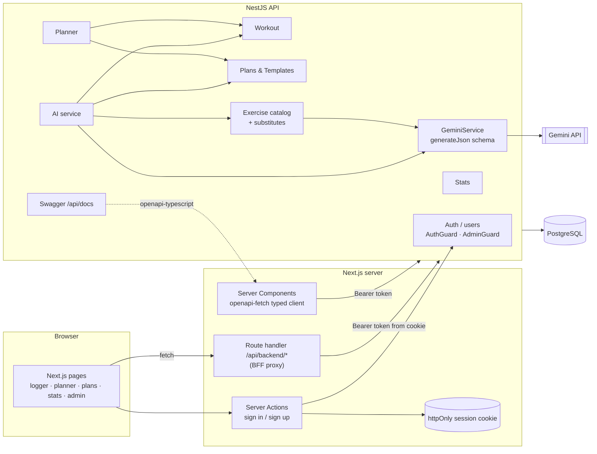
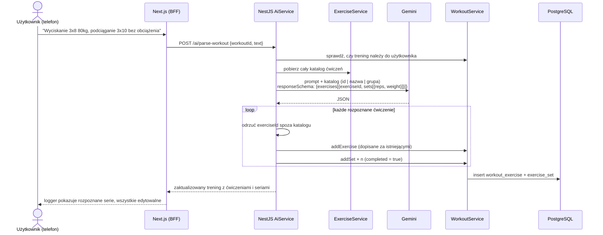
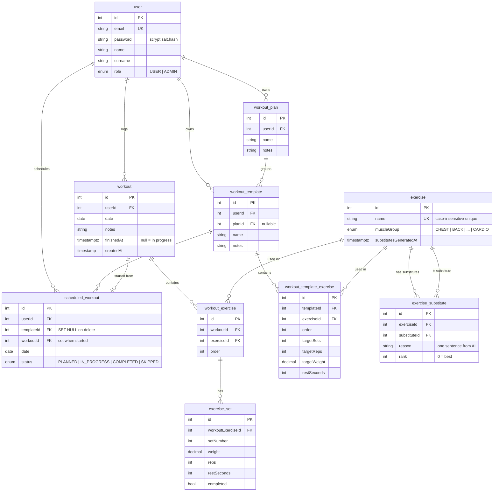

# Workout Tracker

## Opis

Workout Tracker to aplikacja full-stack do treningu siłowego w duchu Strong i Hevy. Użytkownik loguje treningi (ćwiczenia → serie z ciężarem, powtórzeniami i oznaczeniem wykonania), buduje **plany** złożone z **szablonów** (jeden na dzień treningowy, z docelowymi seriami, powtórzeniami, ciężarem i przerwą), rozkłada je w **planerze** i śledzi postępy w rozbudowanych **statystykach**: szacowany 1RM, rekordy osobiste, rekordy powtórzeń, tygodniowa objętość, rozkład grup mięśniowych, serie dni treningowych, realizacja planu i wykrywanie stagnacji.

Trzy funkcje korzystają z **Google Gemini**, zawsze w granicach istniejącego katalogu ćwiczeń:
- **Trening z tekstu:** *„wyciskanie 3x8 80 kg, potem podciąganie 3x10”* staje się zapisanymi ćwiczeniami i seriami.
- **Generowanie planu** na podstawie celu (siła, hipertrofia, wytrzymałość lub ogólny), liczby dni w tygodniu i ograniczeń.
- **Dobór zamienników:** do każdego ćwiczenia AI wybiera do 5 alternatyw o tym samym wzorcu ruchu, każdą z jednozdaniowym uzasadnieniem. Admin może je przejrzeć i odrzucić.

Zbudowałem ją jako projekt na studia, więc celem był kompletny system, w którym każda funkcja backendu jest dostępna z dopracowanego UI.

## Problem

Logowanie na siłowni musi być szybkie: telefon w ręce, przerwa między seriami, zmęczone dłonie. Planowanie i przegląd postępów odbywają się natomiast przy biurku. Popularne aplikacje każą też budować każdy plan ręcznie i mało mówią o tym, *dlaczego* postęp stanął.

Ta aplikacja:
- sprawia, że logowanie jest **szybkie i wyrozumiałe**: logger projektowany pod telefon, duplikowanie treningów, start sesji wypełnionej danymi z szablonu i opcjonalny skrót „po prostu napisz, co zrobiłeś”,
- zamienia **plany w kalendarz** i śledzi ich realizację (zaplanowane vs wykonane vs pominięte),
- pokazuje **postępy, które motywują**: rekordy, serie dni, wykresy e1RM, plus listę ćwiczeń, w których nastąpiła stagnacja,
- traktuje AI jako **asystenta, którego wynik można sprawdzić**, a nie czarną skrzynkę. Wygenerowane plany i sparsowane treningi to zwykłe, edytowalne dane.

## Kluczowe funkcje

- **Logowanie treningów:** tworzenie, edycja, duplikowanie, kończenie i anulowanie treningów. Dodawanie ćwiczeń z katalogu oraz dodawanie, edycja i odhaczanie serii.
- **Plany i szablony:** plan grupuje szablony, a każde ćwiczenie w szablonie ma kolejność, docelowe serie, powtórzenia, ciężar i przerwę. Ćwiczenie można podmienić na zamiennik zaproponowany przez AI.
- **Planer:** szablony rozpisane na daty ze statusami `PLANNED` / `IN_PROGRESS` / `COMPLETED` / `SKIPPED`. Zawiera widok „dziś”, **generowanie harmonogramu** (np. Push → poniedziałek, Pull → środa, Legs → piątek w zadanym zakresie dat, bez nadpisywania istniejących wpisów) oraz **start zaplanowanego treningu**, który tworzy prawdziwy trening wypełniony wartościami docelowymi z szablonu.
- **Statystyki:** postęp w ćwiczeniu (maksymalny ciężar, objętość, e1RM wg Epleya), rekordy osobiste, rekordy dla 1/3/5/8/10/12 powtórzeń, rekordy ogólne, rozkład grup mięśniowych, częstotliwość, aktualna seria, statystyki tygodniowe, podział na zakresy powtórzeń (siła, hipertrofia, wytrzymałość), realizacja planu, wykrywanie stagnacji i podsumowanie.
- **Katalog ćwiczeń:** pogrupowany według grup mięśniowych (`CHEST`, `BACK`, `SHOULDERS`, `BICEPS`, `TRICEPS`, `LEGS`, `GLUTES`, `ABS`, `FULL_BODY`, `CARDIO`), z wyszukiwarką i stroną szczegółów.
- **Funkcje AI:** tekst → trening, cel → plan, dobór zamienników dla całego katalogu.
- **Panel admina:** zarządzanie katalogiem ćwiczeń (z kontrolą użycia przed usunięciem), zarządzanie użytkownikami oraz ponowne generowanie i odrzucanie zamienników AI.
- **Role:** `USER` i `ADMIN`, egzekwowane guardami.
- **i18n:** interfejs po polsku i angielsku z przełącznikiem języka (next-intl).
- **Dokumentacja Swagger** pod `/api/docs`, z przykładami dla każdej encji i DTO.

## Stack technologiczny

| Warstwa | Technologia | Dlaczego |
|---|---|---|
| Frontend | Next.js 16 (App Router), React 19, Tailwind v4 | Server Components dla stron z dużą ilością danych (statystyki, planer); komponenty klienckie dla interaktywnego loggera |
| Klient API | `openapi-typescript` + `openapi-fetch` | Typy **generowane ze specyfikacji Swagger backendu**, więc frontend nie rozjedzie się z API |
| Auth (FE) | Ciasteczko httpOnly + `jose` + BFF proxy | Przeglądarka nigdy nie widzi JWT. Route handler Next.js przekazuje `/api/backend/*` z tokenem Bearer, więc backend nie potrzebuje CORS |
| i18n | next-intl | Komunikaty PL/EN, przełącznik języka |
| Backend | NestJS 11 + Swagger | Modularne REST API z udokumentowanymi kontraktami |
| ORM / DB | TypeORM + PostgreSQL | Model relacyjny z kaskadami (trening → ćwiczenia → serie), ciężary jako `decimal`, kolumny `date` |
| AI | Gemini przez `@google/genai` | `responseMimeType: application/json` plus `responseSchema`, więc wynik zawsze ma ustaloną strukturę |
| Walidacja | class-validator + globalny `ValidationPipe` | Każde ciało żądania jest sprawdzane względem DTO |
| Testy | Jest | Testy jednostkowe serwisów, kontrolerów i helperów statystyk |

## Architektura



Logowanie i rejestracja idą przez **Server Actions**, więc token nigdy nie pojawia się w odpowiedzi, którą przeglądarka mogłaby odczytać. Pozostałe wywołania po stronie klienta przechodzą przez **BFF proxy**, które bierze token z ciasteczka httpOnly i dodaje nagłówek `Authorization`.

## Przepływ danych: trening z tekstu



Generowanie planu działa tak samo: katalog trafia do promptu, schemat JSON ogranicza format odpowiedzi, nieznane ID są odrzucane, a wynik zapisuje się jako zwykły `WorkoutPlan` z `WorkoutTemplate`, które użytkownik może potem edytować.

## Schemat bazy danych



Zamienniki są **kierunkowe** (A → B nie oznacza B → A) i unikalne dla każdej pary. Usunięcie szablonu zachowuje historię harmonogramu (`SET NULL`), a start zaplanowanego treningu łączy wpis z utworzonym prawdziwym `workout`.

## Najważniejsze endpointy API

Wszystkie endpointy są udokumentowane w Swaggerze (`/api/docs`). Główne grupy:

| Grupa | Przykłady |
|---|---|
| Auth | `POST /auth/signup`, `POST /auth/signin`, `GET /auth/context`, `GET /auth/users` (admin) |
| Trening | `POST /workout`, `POST /workout/:id/duplicate`, `POST /workout/:id/finish`, `POST /workout/:workoutId/exercise/:weId/set` |
| Plany / szablony | `POST /plan`, `POST /template`, `POST /template/:templateId/exercise` |
| Planer | `POST /planner/generate`, `GET /planner/today`, `POST /planner/scheduled/:id/start` |
| Statystyki | `/stats/exercise/:id/progress`, `/stats/records`, `/stats/streak`, `/stats/weekly`, `/stats/adherence`, `/stats/stagnation`, `/stats/rep-ranges` |
| Ćwiczenia | `GET /exercise`, `GET /exercise/:id/substitutes`, `POST /exercise/substitutes/generate` (admin) |
| AI | `POST /ai/generate-plan`, `POST /ai/parse-workout` |

**Przykład: generowanie planu**

```http
POST /ai/generate-plan
Authorization: Bearer <jwt>
Content-Type: application/json

{ "goal": "HYPERTROPHY", "daysPerWeek": 3, "constraints": "bez przysiadów ze sztangą, problem z odcinkiem lędźwiowym" }
```

```json
{
  "plan": { "id": 12, "name": "Plan HYPERTROPHY — 3x/tydzień", "notes": "bez przysiadów ze sztangą, problem z odcinkiem lędźwiowym" },
  "templates": [
    {
      "id": 31,
      "name": "Push",
      "exercises": [
        { "order": 0, "exercise": { "id": 1, "name": "Wyciskanie sztangi leżąc", "muscleGroup": "CHEST" },
          "targetSets": 4, "targetReps": 10, "targetWeight": 60, "restSeconds": 90 }
      ]
    }
  ]
}
```

<!-- TODO: podmienić na prawdziwą odpowiedź z bazy po seedzie -->

**Przykład: generowanie harmonogramu z planu**

```json
POST /planner/generate
{
  "from": "2026-10-05", "to": "2026-11-01",
  "assignments": [
    { "templateId": 31, "dayOfWeek": 1 },
    { "templateId": 32, "dayOfWeek": 3 },
    { "templateId": 33, "dayOfWeek": 5 }
  ]
}
```

## Przykładowy przebieg

1. **Rejestracja**, po której dashboard pokazuje onboarding i kartę „AI na start”. *(screen: dashboard.png)*
2. **Generowanie planu:** cel *Hipertrofia*, 3 dni w tygodniu, ograniczenie *„bez przysiadów ze sztangą”*. W edytorze planu pojawiają się trzy szablony (Push, Pull, Legs). Każdy można przemianować, przestawić albo podmienić w nim ćwiczenie na zamiennik od AI, np. *„Suwnica – ten sam wzorzec przysiadu, czworogłowe i pośladki”*. *(screen: plan-editor.png)*
3. **Harmonogram:** przypisanie Push → poniedziałek, Pull → środa, Legs → piątek na najbliższe 4 tygodnie. Tablica planera wypełnia się sesjami `PLANNED`. *(screen: planner.png)*
4. **Trening:** w poniedziałek karta „Dziś” pokazuje *Push*. Kliknięcie **Start** tworzy trening wypełniony docelowymi seriami, powtórzeniami i ciężarem. Użytkownik koryguje ciężary i odhacza serie na telefonie. *(screen: log.png)*
5. **Skrót:** innego dnia użytkownik wpisuje *„OHP 3x8 40kg, wznosy bokiem 3x15 10kg”*, a AI dodaje do treningu oba ćwiczenia i wszystkie sześć serii. *(screen: parse.png)*
6. **Koniec treningu:** trening dostaje `finishedAt`, a wpis w planerze zostaje oznaczony jako wykonany.
7. **Przegląd postępów:** statystyki pokazują trend e1RM w wyciskaniu, nowy rekord na 8 powtórzeń, rozkład grup mięśniowych, 3-tygodniową serię, realizację planu i ostrzeżenie, że *wiosłowanie sztangą* stoi w miejscu od 6 tygodni. *(screen: stats.png)*

## Kluczowe decyzje i kompromisy

- **AI ograniczone do katalogu.** Każdy prompt zawiera katalog z ID, wynik jest ograniczony schematem JSON, a niepoprawne ID są odfiltrowywane na serwerze. AI nie wymyśli ćwiczeń, które zepsułyby statystyki, kosztem większych promptów.
- **Wynik AI to zwykłe dane.** Wygenerowany plan czy sparsowany trening zapisują się jako normalne encje, więc ich edycja nie wymaga osobnej ścieżki w kodzie.
- **Awaria AI nie blokuje podstawowych akcji.** Zapis ćwiczenia działa nawet przy niedostępnym Gemini: zamienniki są oznaczone jako „niedobrane” (`substitutesGeneratedAt = null`) i można je wygenerować później z panelu admina. Generowanie hurtowe ponawia przy błędach przejściowych (`503` po 5 s, `429` według `retryDelay` z API, maksymalnie 60 s), a w pozostałych przypadkach zwraca czytelny `502 Bad Gateway`.
- **Statystyki liczone w TypeScripcie zamiast w SQL.** Ukończone serie są pobierane raz i przetwarzane przez czyste funkcje (`computePersonalRecords`, `computeStagnation`, `computeAdherence`…). Łatwo je testować i wystarczają w skali osobistego dziennika, ale przy dużej skali trzeba by przejść na agregację w SQL.
- **Generowane typy API (OpenAPI → TypeScript).** Adnotacje Swaggera służą jednocześnie jako dokumentacja i źródło typów frontendu, co w trakcie pracy wyłapało kilka niezgodności kontraktu.
- **BFF proxy zamiast CORS.** JWT w ogóle nie trafia do JavaScriptu, kosztem jednego dodatkowego przeskoku.
- **`synchronize: true` zamiast migracji.** Przyspieszyło iteracje przy projekcie na studia. Wdrożenie produkcyjne wymagałoby przejścia na migracje.

## Wyzwania i rozwiązania

- **Dopasowanie swobodnego tekstu do stałego katalogu.** Użytkownicy piszą „bench”, „klata” czy „OHP”. Przekazanie całego katalogu (`id | nazwa | grupa`) i wymóg podawania ID w schemacie sprawiły, że dopasowanie jest niezawodne. To, czego nie da się dopasować, jest pomijane, a nie zgadywane.
- **Dobre zamienniki, a nie tylko ta sama grupa mięśniowa.** Prompt wymaga tego samego **wzorca ruchu** (pionowe przyciąganie, poziome wypychanie, przysiad, zawias biodrowy…) i podobnych głównych mięśni, pozwala zwrócić pustą listę zamiast słabego dopasowania i prosi o krótkie uzasadnienie. Serwer usuwa duplikaty i odwołania do samego siebie, a zostawia 5 najlepszych według rangi.
- **Stagnacja, która coś znaczy.** Ćwiczenie uznaje się za stojące w miejscu tylko wtedy, gdy było ostatnio trenowane (w ciągu 21 dni), co najmniej 3 razy, a najlepszy wynik nie poprawił się od 42 dni. Samo wyrównanie rekordu nie resetuje licznika.
- **Strefy czasowe przy „dziś”.** `GET /planner/today` przyjmuje lokalną datę klienta, więc trening o 00:30 nie ląduje na złym dniu.

## Testy i jakość

- **Testy jednostkowe (Jest):** serwisy i kontrolery treningów, ćwiczeń, statystyk i użytkowników, plus rozbudowane testy czystych helperów statystyk (rekordy, zakresy powtórzeń, stagnacja, realizacja planu, statystyki tygodniowe).
- Globalny `ValidationPipe` i wspólny `HttpExceptionFilter` z udokumentowanym formatem `ErrorResponse`.
- ESLint + Prettier.
- Przykładowe żądania dla każdego modułu w plikach `*.http`.

## Bezpieczeństwo

- Hasła hashowane **scrypt** z losową solą; kolumna z hasłem jest wykluczona z serializacji.
- Autoryzacja JWT (`AuthGuard`) na wszystkich trasach poza auth, `AdminGuard` dla zarządzania katalogiem i użytkownikami.
- Sprawdzanie właściciela każdego zasobu (`findOwned(userId, id)`).
- Frontend trzyma token w **ciasteczku httpOnly** za BFF proxy; logowanie i rejestracja idą przez Server Actions.

## Uruchomienie lokalne

Wymagania: Node.js, PostgreSQL i klucz API Gemini.

```bash
# backend (port 3000)
cd backend
# .env: DB_HOST, DB_PORT, DB_USER, DB_PASS, DB_NAME, sekret JWT, GEMINI_API_KEY, GEMINI_MODEL
npm install
npm run start:dev
npm run seed                  # użytkownicy demo, katalog ćwiczeń, treningi
# Swagger: http://localhost:3000/api/docs

# frontend (port 3001)
cd ../frontend
cp .env.example .env.local    # BACKEND_URL=http://localhost:3000
npm install
npm run dev
```

<!-- TODO: dodać backend/.env.example do repozytorium -->

## Ograniczenia i plany

- Synchronizacja schematu zamiast migracji i na razie brak CI.
- Nazwy ćwiczeń w katalogu są tylko po polsku; tłumaczenie katalogu to wciąż otwarta kwestia.
- Pomysły: timer przerw, sugestie progresji na podstawie danych o stagnacji, kalkulator talerzy, eksport do CSV, PWA i logowanie offline.

## Czego się nauczyłem

- Projektowania nietrywialnego modelu relacyjnego (plany → szablony → zaplanowane sesje → treningi → serie) z sensownymi regułami kaskad.
- Bezpiecznego używania **ustrukturyzowanego wyniku LLM**: zakotwiczenie w zamkniętym katalogu, JSON ograniczony schematem, walidacja po stronie serwera i łagodna degradacja przy awarii.
- **Podejścia contract-first w full stacku:** Swagger → generowane typy TypeScript → typowany klient fetch.
- Bezpiecznej obsługi sesji w Next.js z **BFF proxy** i ciasteczkami httpOnly.
- Zamieniania surowych logów treningowych w **użyteczne metryki** (e1RM, rekordy powtórzeń, stagnacja, realizacja planu) za pomocą czystych, testowalnych funkcji.
